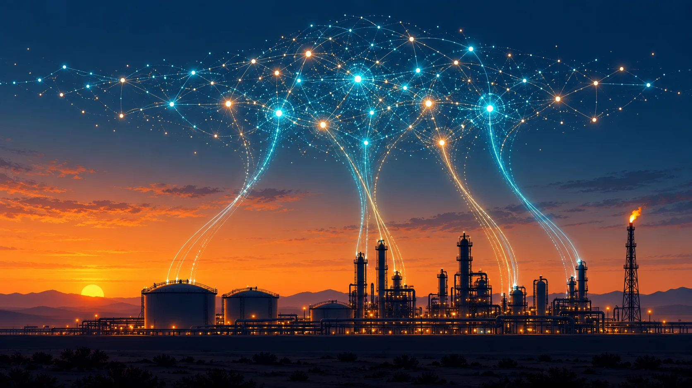
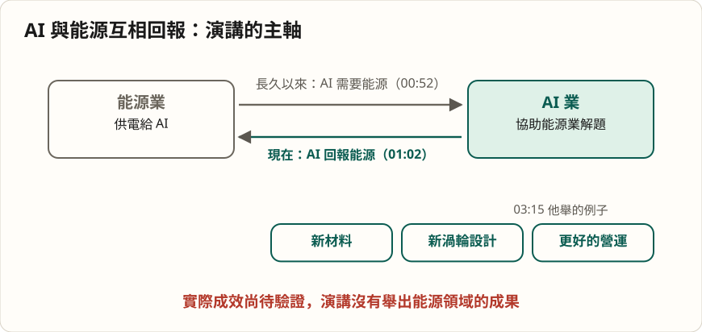
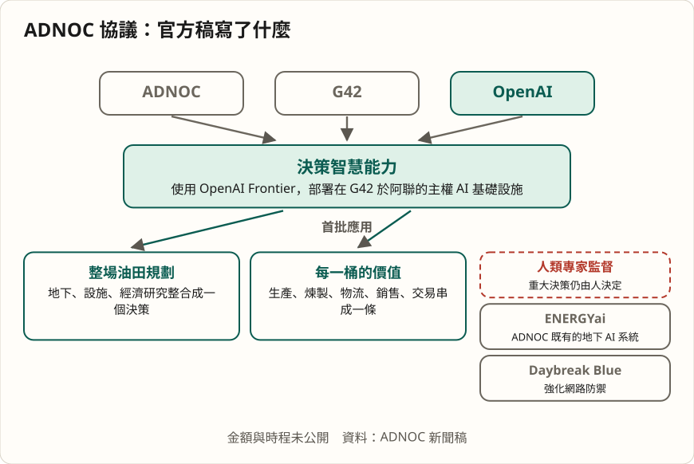
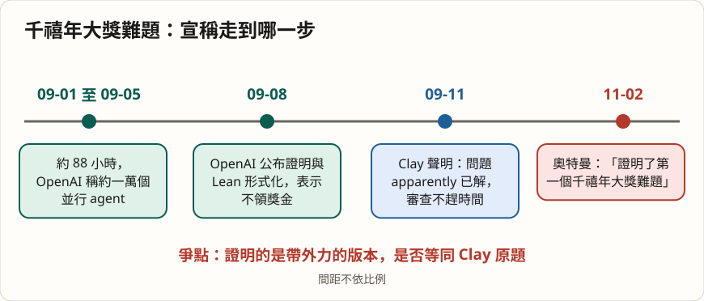

# AI 向能源回報這份恩情：奧特曼在 ADIPEC 開幕式上說了什麼

*圖說：AI 生成的概念插畫，比喻能源設施與 AI 系統互相供給：一邊供電，一邊回饋。*

> 這是一篇導讀：先給重點與查證，再依演講順序看他說了什麼、哪些說法要打折。本導讀的分析與撰稿由 AI 模型完成，不是人類分析，也沒有經過人工逐句校稿，見〈製作說明〉。

2026 年 11 月 2 日，第 42 屆阿布達比國際石油展覽暨會議（ADIPEC）開幕。OpenAI 執行長山姆・奧特曼（Sam Altman）被請上台，先講約七分鐘，再由《The National》總編輯米娜・奧賴比（Mina Al-Oraibi，依職稱推定）訪談約十分鐘（[00:20](https://www.youtube.com/watch?v=2YWfVGpVtvc&t=20s)、[06:47](https://www.youtube.com/watch?v=2YWfVGpVtvc&t=407s)）。同一天，阿布達比國家石油公司（ADNOC）宣布與 OpenAI、G42 簽下多年合作，成為第一家部署 OpenAI Frontier 的能源公司。

奧特曼一開口，就接著 ADNOC 執行長蘇爾坦・賈比爾（Sultan Al Jaber）博士稍早的一句話，把一個長年的單向關係翻過來：長久以來，AI 產業一直在談它需要能源產業提供什麼，「而現在我認為我們能夠回報這份恩情了」（[00:52](https://www.youtube.com/watch?v=2YWfVGpVtvc&t=52s)–[01:02](https://www.youtube.com/watch?v=2YWfVGpVtvc&t=62s)）。這場演講的主軸就是這句話，其餘的數學難題、agent、token 成長，是他用來支撐它的論據。

## 三十秒版

- 奧特曼的論點分兩半：**AI 需要大量能源，現在 AI 也強到能幫能源業解決自己的難題**（新材料、新渦輪設計、更好的營運）。他說這是「模型首次具備」的能力，只出現幾個月（[03:28](https://www.youtube.com/watch?v=2YWfVGpVtvc&t=208s)）。
- 他拿來證明模型能力的例子是：OpenAI 用約 10,000 個 agent、約四天，「證明了第一個千禧年大獎難題」（[05:40](https://www.youtube.com/watch?v=2YWfVGpVtvc&t=340s)）。**這是 OpenAI 的宣稱**，Clay 數學研究所還在審查，且證明的是帶外力的版本，是否等同原題仍有爭議。
- 被問到今天面臨的一項挑戰，他的回答是「能源」：模型效率、機器人、晶圓廠都會大幅進步，「原子終究還是原子」，供電的實體世界會是成本與產出的主導因素（[15:34](https://www.youtube.com/watch?v=2YWfVGpVtvc&t=934s)）。
- 談到風險，他給了一條明確的線：**人要掌控未來，不該把決策漸進式地交給 AI**（[13:40](https://www.youtube.com/watch?v=2YWfVGpVtvc&t=820s)）。演講沒有說怎麼落實。
- 阿聯年輕人的 ChatGPT 使用率與 token 用量這兩組數字都是他口述，沒有出處可核對。

## 先看重點：演講中的說法，查得到什麼

| 演講中的說法 | 查證結果 | 狀態 |
|---|---|---|
| ADNOC 與 G42、OpenAI 合作；ADNOC 是第一家採用 OpenAI Frontier 的能源公司（[08:15](https://www.youtube.com/watch?v=2YWfVGpVtvc&t=495s)，主持人說明） | ADNOC 新聞稿同日發布，載明多年合作、首家部署；未揭露金額 | 已確認 |
| 「證明了第一個千禧年大獎難題」，10,000 個 agent、約 4 天（[05:40](https://www.youtube.com/watch?v=2YWfVGpVtvc&t=340s)） | OpenAI 9/8 公布 Navier–Stokes 證明（約 10,000 個並行 agent、約 88 小時）；Clay 9/11 聲明稱問題「apparently」已解、審查不趕時間；證明對象為帶外力版本 | 有爭議 |
| 阿聯約 80% 年輕人是 ChatGPT 週活使用者（[07:35](https://www.youtube.com/watch?v=2YWfVGpVtvc&t=455s)） | 他自己加了「我想」；找不到官方數字 | 單方，講者口述 |
| 6 年前最高 token 用量者每月 10 萬，現在全球人均約 10 萬、最高用量者約 5,000 億（[11:02](https://www.youtube.com/watch?v=2YWfVGpVtvc&t=662s)） | 查無官方資料可核對 | 單方，講者口述 |
| 今年初 AI 大多不如最聰明的科學家，現在大多更聰明（[11:55](https://www.youtube.com/watch?v=2YWfVGpVtvc&t=715s)） | 他自己註明「非常概略」「不均勻」；屬判斷，無從查證 | 講者判斷 |
| 「GPT-6 以及未來模型」（[04:04](https://www.youtube.com/watch?v=2YWfVGpVtvc&t=244s)） | GPT-6 系列已在 9 月起陸續推出（CNBC 9/3 報導 Astra 開始推出） | 已確認 |

## 一、先說回報：從「AI 要電」到「AI 幫能源」

演講的開頭其實沒有談模型。奧特曼先說自己的職涯有兩個最大的興趣，一個是 AI，一個是能源，「我從沒想過兩者會以這樣的方式結合在一起」（[01:14](https://www.youtube.com/watch?v=2YWfVGpVtvc&t=74s)）。

接著是他的邏輯鏈：讓人擁有新想法、更多使用 AI 的潛力固然好，**真正要讓事情在實體世界發生，需要更多能源**（[01:21](https://www.youtube.com/watch?v=2YWfVGpVtvc&t=81s)）。他因此對兩件事都興奮：AI 開始協助能源產業，以及人們拿著 AI 得來的靈感與槓桿，在充沛能源下做出什麼（[01:36](https://www.youtube.com/watch?v=2YWfVGpVtvc&t=96s)）。

這一段講的是方向。他把 AI 與能源的關係講成雙向：**供電是 AI 的條件，AI 反過來要提高供電的效率與充裕度**。

*圖說：本文歸納的演講主軸，不是講者原圖。*

## 二、為什麼說是「現在」：從工作效率到科學發現

他把近年的 AI 分成兩層。第一層是工作效率：人用 ChatGPT 更有效率地做事，甚至把 AI 當成虛擬同事，用更少的人完成更多工作（[02:03](https://www.youtube.com/watch?v=2YWfVGpVtvc&t=123s)）。第二層才是他更興奮的：**發現**。「在過去幾個月裡，我們看到 AI 開始解決人類一直無法解開的數學難題」（[02:36](https://www.youtube.com/watch?v=2YWfVGpVtvc&t=156s)）。

他接著把這個能力接到能源業。能源公司如果說「我需要更有效率地生產更多能源」，也許需要新材料、新的渦輪設計、更好的營運，「要求一個精密的 AI 系統來找出答案」，他認為會改變能源的充裕度與效率；而且「我們現有的模型首次具備了這樣的能力。這真的只是幾個月前才出現的突破」（[03:15](https://www.youtube.com/watch?v=2YWfVGpVtvc&t=195s)–[03:34](https://www.youtube.com/watch?v=2YWfVGpVtvc&t=214s)）。

> 重點：這是整場演講的核心主張，也是最難獨立檢驗的一句。

「首次」與「幾個月前」是他的判斷，演講沒有舉出能源領域的具體成果，只舉了數學的例子。能源業的實證，要看下一節的合作能做出什麼。

## 三、與 ADNOC 的合作：官方稿寫了什麼

奧特曼在演講裡的措辭很短：與 ADNOC 合作，要把 ChatGPT、GPT-6 和未來模型交到大家手上，「但我認為現在我們真正有機會成就某種具變革性的事物」（[04:04](https://www.youtube.com/watch?v=2YWfVGpVtvc&t=244s)）。

細節來自同日的 ADNOC 新聞稿。協議是多年期，三方要共同開發一套量身打造的決策智慧能力，部署在 G42 於阿聯的主權 AI 基礎設施上。首批應用有兩個：一是整場油田規劃，把地下、設施與經濟研究整合成一個決策；二是「每一桶的價值」，把生產、煉製、物流、銷售與交易串起來，由 AI agent 預測原油供需、價格與利潤。新聞稿同時寫明，重大決策仍由人類專家監督；合作也包含透過 OpenAI 的 Daybreak Blue 強化 ADNOC 的網路防禦。新聞稿沒有揭露金額，也沒有交付時程。

*圖說：依 ADNOC 新聞稿整理的結構，不是官方原圖。*

訪談裡，主持人問這項協議如何重塑能源產業。奧特曼談的是方向：G42、ADNOC 與 OpenAI 三方談了幾年，「現在模型的能力已經跟上了」，要鎖定 ADNOC 最棘手、最有價值的問題，用最前沿的 AI 加上大量算力，「迅速產出巨大的成果」（[08:44](https://www.youtube.com/watch?v=2YWfVGpVtvc&t=524s)–[09:16](https://www.youtube.com/watch?v=2YWfVGpVtvc&t=556s)）。他也認為，大家的夢想都還不夠大，因為習慣了去年的模型，「我認為，正面的驚喜將會超出我們所有人的預期」（[09:26](https://www.youtube.com/watch?v=2YWfVGpVtvc&t=566s)–[09:42](https://www.youtube.com/watch?v=2YWfVGpVtvc&t=582s)）。主持人接話（依字幕換人標記判斷）：夢想不夠大在阿聯從來不是問題（[09:46](https://www.youtube.com/watch?v=2YWfVGpVtvc&t=586s)）。

## 四、「新文藝復興」與一萬個 agent

他說大家一直把 AI 稱為新的工業革命，「那樣形容也沒錯」，但現在看到的潛力好得多，他們開始用的說法是「新的文藝復興」：一個人和 AI 坐下來討論廣泛的難題，提出精密的解決方案，發明新東西，大幅撬動自己對問題的理解與對社會的貢獻（[04:17](https://www.youtube.com/watch?v=2YWfVGpVtvc&t=257s)–[04:39](https://www.youtube.com/watch?v=2YWfVGpVtvc&t=279s)）。

他回到前面的數學例子，說那是他在 AI 歷史上見過最不可思議的時刻之一：

> 我想各位很快就能在我們的企業中見證這樣的時刻——當時我們證明了第一個千禧年大獎難題。那是由即將推出的下一代 GPT 模型的 10,000 個 agent 所完成的，運作了大約 4 天，不間斷地彼此完美協作。沒有階級之分。沒有老闆。完全是去中心化的。（[05:40](https://www.youtube.com/watch?v=2YWfVGpVtvc&t=340s)–[06:01](https://www.youtube.com/watch?v=2YWfVGpVtvc&t=361s)，機器翻譯）

第一句的「我們的企業」在字幕裡語意不清，語音轉寫也是同樣用字，這裡照字面翻。

他描述的 agent 行為是：各自探索想要的方向、分享進度、彼此學習、自主決定要做什麼（[06:03](https://www.youtube.com/watch?v=2YWfVGpVtvc&t=363s)）。

> 重點：這句話把一項仍在審查的宣稱說成了已完成。

OpenAI 在 9 月 8 日公布其內部模型的 Navier–Stokes 證明，附 Lean 形式化；公布的規模是約 10,000 個並行 agent、約 88 小時，與他說的「約 4 天」大致相符。OpenAI 也寫明不打算領取這項成果的千禧年大獎。

爭點在證明的對象。它證明的是**帶有光滑外力的流體會形成奇異點**，OpenAI 主張這滿足 Clay 題目表述的 C、D 兩個變體；外力版本是否等同 Clay 的原題，仍有爭議。Clay 9 月 11 日的聲明說問題「apparently」（看來）已被解決，審查「刻意不趕時間」，**目前沒有正式認定**。NYU 的 Tristan Buckmaster 另對成果的來歷提出質疑，OpenAI 否認。

*圖說：本文歸納的時間線，間距不依比例，不是講者原圖。*

奧特曼說的「去中心化、沒有老闆」是他對 agent 協作方式的描述，沒有其他來源可核對。

## 五、問答：阿聯、能源需求與 token

**阿聯為什麼特別。** 被問到阿布達比的做法有何不同，他認為阿聯一直是全球最前瞻的 AI 採用國，從 ChatGPT 剛推出，甚至更早，就決定全面押注，並說「我想有 80% 的年輕人是 ChatGPT 的每週活躍使用者」，是所有國家中最高的之一（[07:18](https://www.youtube.com/watch?v=2YWfVGpVtvc&t=438s)–[07:43](https://www.youtube.com/watch?v=2YWfVGpVtvc&t=463s)）。這個 80% 帶著「我想」，沒有定義年齡範圍，也沒有官方數字可核對，只能當他的口述。

**AI 要用多少電。** 主持人問五年後在「AI 要多少電」與「AI 能釋放什麼」之間會落在哪。他的回答有兩層。一層是每次查詢所需的能源正在急劇下降，效率「可能比三、四年前提高了數千倍甚至數十萬倍」，但效率越高，人們越想多用（[10:23](https://www.youtube.com/watch?v=2YWfVGpVtvc&t=623s)–[10:41](https://www.youtube.com/watch?v=2YWfVGpVtvc&t=641s)）。他的立場是：**AI 與能源業有責任讓這件事發生**，醫療建議、每個孩子的教育、更高的生活品質都值得人們大量使用（[10:41](https://www.youtube.com/watch?v=2YWfVGpVtvc&t=641s)）。

另一層是他那個「覺得很驚人」的統計：六年前，全球 token 用量最高的人在 OpenAI，每月 10 萬個 token，「當時看來簡直不可思議」，全球人均大約是零；現在全球人均每月約 10 萬，用量最高的人約 5,000 億個（[11:02](https://www.youtube.com/watch?v=2YWfVGpVtvc&t=662s)–[11:24](https://www.youtube.com/watch?v=2YWfVGpVtvc&t=684s)）。他據此認為：成長速度難以置信，這個趨勢會持續，要讓人們能用上。這組數字沒有出處，也沒說「人均」怎麼算，只能當他對成長幅度的描述。

他也說希望「遠遠回報」AI 所消耗的能源，讓全球能源供應有淨增益（[11:38](https://www.youtube.com/watch?v=2YWfVGpVtvc&t=698s)），但沒有給指標與驗收方式。

## 六、工作、安全，與「人要掌控未來」

主持人轉到大家的焦慮。他先給了一段判斷，並自己標明「非常概略」，因為能力是不均勻的，並非在所有面向都成立。今年初 AI「大多還不如我們最聰明的科學家」，現在「大多比他們更聰明」；當時大多無法勝任許多白領工作，現在大多能處理其中的許多環節（[11:55](https://www.youtube.com/watch?v=2YWfVGpVtvc&t=715s)–[12:14](https://www.youtube.com/watch?v=2YWfVGpVtvc&t=734s)）。

他對工作的預測偏樂觀：人們會被提醒，人有多在乎彼此，人類的創造力與判斷力有多重要，也希望由人來為判斷承擔責任；經濟看似極具顛覆性，但「我們能順利走過」，會找到調整工作的方式（[12:18](https://www.youtube.com/watch?v=2YWfVGpVtvc&t=738s)–[12:35](https://www.youtube.com/watch?v=2YWfVGpVtvc&t=755s)）。接著他補了一個但書：系統變得這麼聰明，會浮現重大問題，**我們該如何保證、並讓世界安心，確認能避免嚴重的安全性與對齊事件**，這對產業愈來愈重要，必須拿出證明（[12:39](https://www.youtube.com/watch?v=2YWfVGpVtvc&t=759s)–[12:51](https://www.youtube.com/watch?v=2YWfVGpVtvc&t=771s)）。

主持人追問他如何看自己的責任。他的回答是整場最有規範意味的一段：

> 我們不認為自己應該成為決策者，但我們看見了未來的趨勢，同時我們也不認為自己應該做沒有道德立場的工具製造者。……我們認為由人類掌控未來是絕對至關重要的。……不應該把主導權交給 AI，絕不能漸進式地讓 AI 來決定什麼對我們最好。AI 必須是為人類打造、為人類服務的工具，而不是反過來。（[13:24](https://www.youtube.com/watch?v=2YWfVGpVtvc&t=804s)–[13:57](https://www.youtube.com/watch?v=2YWfVGpVtvc&t=837s)，機器翻譯，中略處以刪節號標示）

他也說，他不敢相信這竟能讓 OpenAI 與其他 AI 公司區隔開來，「但事實確實如此」；並希望這種話「根本不需要被一再強調」（[13:34](https://www.youtube.com/watch?v=2YWfVGpVtvc&t=814s)–[14:05](https://www.youtube.com/watch?v=2YWfVGpVtvc&t=845s)）。

> 重點：這是價值主張，演講沒有說明機制。

同一天的 ADNOC 新聞稿寫的是重大決策仍由人類專家監督，方向一致；至於 agent 能自主運作四天、沒有老闆時，監督落在哪一步，兩邊都沒有講到。

## 七、ChatGPT 的起點與快問快答

被問到有沒有預料到 ChatGPT 的影響，他說 AI 一定會改變世界，但當時並不知道 ChatGPT 會是引爆的那個產品：「GPT-3.5 成為第一個足夠優秀的模型，加上對話是絕佳的產品形態，那個特定的交會點」，他們對此樂觀，但不知道那就是關鍵時刻（[14:25](https://www.youtube.com/watch?v=2YWfVGpVtvc&t=865s)–[14:50](https://www.youtube.com/watch?v=2YWfVGpVtvc&t=890s)）。

快問快答裡，被問今天面臨的一項挑戰，他的回答是「能源」，台下笑了，接著補一句：「我們接下來四天要來解決它」，指的是這場會議（[15:07](https://www.youtube.com/watch?v=2YWfVGpVtvc&t=907s)）。隨後他把這題講完：其他一切都會有巨大進展，包括更有效率的模型、能提高晶圓廠效率並組裝機架的機器人；降低提供強大 AI 的成本幾乎各方面都辦得到，**除了「原子終究還是原子」，必須供電的實體世界**，那將是成本、豐富度與能創造多少成果的**極關鍵因素**（[15:24](https://www.youtube.com/watch?v=2YWfVGpVtvc&t=924s)–[15:49](https://www.youtube.com/watch?v=2YWfVGpVtvc&t=949s)）。

最後一題問未來有什麼讓他興奮。他說看著模型能做的事，他「有些」敬畏，尤其是看孩子們使用：他們成長中從不曾懷疑電腦做不到他們要求的事，而他自己會先想「那個問題大概太難了，我甚至不想試」；讓人坐在電腦前構想任何願望並與 AI 共同創造，加上 AI 開創的新科學，「這實在太不可思議了」（[16:05](https://www.youtube.com/watch?v=2YWfVGpVtvc&t=965s)–[16:54](https://www.youtube.com/watch?v=2YWfVGpVtvc&t=1014s)）。

## 讀這場演講要記得的限制

- **單一視角，場合特殊。** 講者是 OpenAI 的執行長，場合是 ADNOC 合作簽署當天的開幕式，聽眾是能源業。他的措辭同時是對客戶、合作夥伴與政府的說法。
- **字幕是機器產生。** 影片是第三方媒體（DRM News）的轉播，英文字幕為 YouTube 自動字幕，沒有說話者標記；本文的說話者歸屬依上下文判斷。
- **影片標題與說明欄的行銷用語**（例如荷莫茲海峽、蘇爾坦・賈比爾博士的演說）屬於同一天的其他內容，不是奧特曼的談話。

## 重點結論與實際啟示

- 主軸是把「AI 需要能源」擴成「能源與 AI 互相回報」：能源業有了採用 AI 的理由，AI 業也多了要求電力的理由。
- 能力說法要分層讀：「模型剛具備解決複雜問題的能力」是他的主張，千禧年大獎難題是宣稱，能源業的實證要等這次合作做出成果。
- 「由人掌控」與 agent 自主運作之間怎麼銜接，是之後值得追蹤的地方。

## 製作說明：這篇導讀由 AI 模型完成

- 分析與撰稿由 AI 模型完成，不是人類分析，也沒有經過人工逐句校稿。主控與撰稿為 Claude Sonnet 5.5；字幕初譯為 Gemini 3.8 Flash（經 agy）；獨立審稿與重要說法查證用三家的輕量模型（Gemini 3.8 Flash low 經 agy、Claude Haiku、OpenAI Codex 的 GPT-6 Luna）各自獨立進行，主控再核對官方與第一手來源。封面插畫由 OpenAI Codex 呼叫 image generation 製作，圖內沒有文字；資訊圖由 AI 撰寫 SVG 腳本繪製。
- 查證原則：重要說法須有兩方以上查證，並對到官方或第一手來源；只有單方者降級標示。
- 引言依據 YouTube 自動英文字幕翻成中文，經 AI 審校，是機器翻譯，不是官方譯文；個別關鍵句以另一套語音轉寫（Whisper）複核過用字，仍不等於人工聽打。說話者歸屬依對話結構判斷。主持人姓名字幕作 Alarabi，本文依其職稱《The National》總編輯推定為 Mina Al-Oraibi。
- 本導讀另附[全文繁中譯文](translation-zh.html)與[雙語同步播放器](player.html)，都是機器翻譯，非官方版本；影片版權屬原頻道。
- 封面是 AI 生成的概念插畫，不是現場畫面；三張資訊圖（主軸、ADNOC 協議結構、千禧年宣稱時間線）是 AI 撰寫 SVG 腳本繪製，內容是本文歸納，不是講者或官方原圖。

## 來源清單

**影片與官方文件**

- [FULL: Sam Altman Announces OpenAI Partnership With ADNOC & G42 to Transform Energy Operations](https://www.youtube.com/watch?v=2YWfVGpVtvc)，DRM News（YouTube），2026-11-02。
- [ADNOC signs landmark partnership agreement with OpenAI and G42, becoming first energy company to deploy OpenAI Frontier technology](https://www.energyconnects.com/opinion/features/2026/november/adnoc-signs-landmark-partnership-agreement-with-openai-and-g42-becoming-first-energy-company-to-deploy-openai-frontier-technology/)，ADNOC 新聞稿（Energy Connects 轉載），2026-11-02。
- [Clay Mathematics Institute：關於 Navier–Stokes 公告的聲明](https://www.claymath.org/news/navier-stokes-announcement/)，2026-09-11。
- [Navier–Stokes 方程式（千禧年大獎難題頁）](https://www.claymath.org/millennium/navier-stokes-equation/)，Clay Mathematics Institute。

**媒體與補充**

- [OpenAI publishes its Navier-Stokes proof and says it will not claim the Millennium Prize](https://thenextweb.com/news/openai-navier-stokes-proof-published-millennium-prize)，The Next Web，2026-09-09。
- [OpenAI announces rollout of GPT-6 Astra model](https://www.cnbc.com/2026/09/03/open-ai-astra-gpt-6-cyber.html)，CNBC，2026-09-03。
- [OpenAI brings GPT-6 to ChatGPT and debuts Intelligent UI](https://9to5mac.com/2026/10/07/openai-brings-gpt-6-to-chatgpt-and-debuts-intelligent-ui/)，9to5Mac，2026-10-07。
- [ADNOC partners with OpenAI and G42 to revolutionize energy sector with AI at ADIPEC 2026](https://gulfnews.com/uae/abu-dhabi/adnoc-partners-with-openai-and-g42-to-revolutionize-energy-sector-with-ai-at-adipec-2026-1.500732521)，Gulf News，2026-11-02。
- [The National：Mina Al-Oraibi 作者頁](https://www.thenationalnews.com/topics/Author/mina-al-oraibi/)，《The National》。
